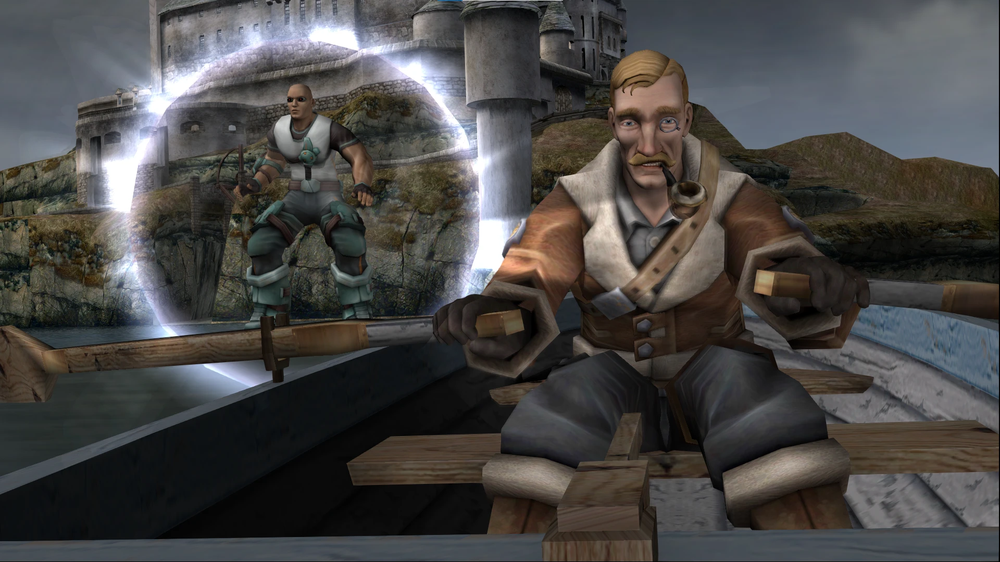
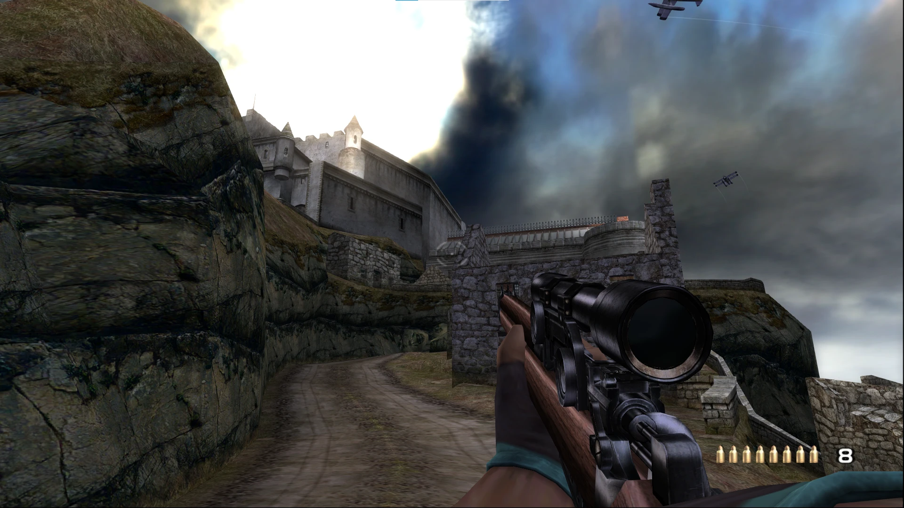
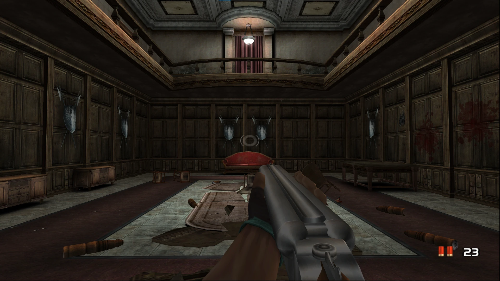

# TimeSplitters: Future Perfect - XBE Recomp
An unofficial native PC port of the original Xbox version of TimeSplitters: Future Perfect, with extended graphics options, keyboard and mouse support, online Story co-op, restored early content and other enhancements.

This port was created using the [Xbox XBE Recomp](https://github.com/TGP482/XboxXBE-Recomp) tool.

> [!NOTE]
> This project does not include any game assets. You must provide the files from your own legally acquired copy of the game (US Xbox release) to install or build.

> [!IMPORTANT]
> This is a fan project. It is not affiliated with, endorsed by or connected to Free Radical Design, Deep Silver, Plaion or Embracer Group. TimeSplitters and TimeSplitters: Future Perfect are trademarks of their respective owners, and all rights to the games belong to them.

<p align="center">
  
</p>
<p align="center">
  
  
</p>

## Download
Get `TSFP.zip` from the [latest release](https://github.com/navasemanuel-lab/TSFP-XBE/releases/latest). The launcher inside installs every later release by itself.

## Installation
- Extract `TSFP.zip` to a folder you can write to.
- Run `TSFP Launcher.exe` and choose **Import / Repair**: pick your disc image (`.iso`) or the `default.xbe` of your extracted game, or drop it on the window. The launcher checks that it is the US release and brings it into the `assets` folder (linked when on the same drive, so it takes no extra space).
- Press **Play**. The launcher checks the files before each launch, and **Verify files** checks them on demand.
- The launcher's **Updates** section installs new releases from this repository. Updates keep your game files, saves and settings.
- Without the launcher: put the disc image or `default.xbe` with its folders in `assets` and run `TSFP.exe`.
- Settings are changed in the overlay, opened with **F1** (or Back + Start on a controller). Every change applies at once and is saved in `settings.toml` beside the exe.

## Features
### Display
- **Resolution and Display Mode** - Any resolution, Fullscreen, Borderless or Windowed, replacing the original 640x480.
- **Aspect Ratio** - From 4:3 up to 32:9.
- **Render Scale** - Renders the game at 1% to 200% of the output resolution.
- **Field of View** - Gameplay and first-person weapon field of view, also available as bars in the game's own Video Options.
- **60 FPS** - The game runs at a steady 60 frames per second.
- **HDR10** - On a display with HDR on in Windows, with Windows' SDR white and the display's peak, or your own.
- **Brightness, V-Sync and FPS Counter**.
- **Shader Cache** - Shaders and pipelines are cached and built ahead at start, so levels don't stutter the first time.

### Graphics
- **Multisample Antialiasing (MSAA)** - 2x, 4x or 8x MSAA smooths jagged edges while keeping the image sharp. It does not smooth alpha-tested edges such as fences and foliage.
- **Edge Smoothing** - FXAA or SMAA over the whole frame, alpha-tested edges included. SMAA keeps text and straight lines sharp, and either can be combined with MSAA.
- **Anisotropic Filtering** - Up to 16x on all textures.
- **Ambient Occlusion** - Soft contact shadows where surfaces meet, SSAO or GTAO, worked out at half size.
- **Effect Toggles** - Switch fog, rain, blood and the first-person hands on or off.
- **PC Fixes** - Falling rain shown, decals at any field of view, overlays that went black at high fields of view fixed, and a cheaper glow pass at high resolutions.

### Input
- **Mouse and Keyboard** - 1:1 mouse aiming with sensitivity, vertical speed and invert. The mouse works in every menu, on the on-screen keyboards and in MapMaker.
- **Rebindable Controls** - Every action takes up to three keys, and 1 to 9 and 0 pick the weapons in your inventory. The keyboard can be its own player, with controllers on ports 2 to 4.
- **Controller** - Xbox, PlayStation and Switch controllers with hot plugging, rumble, dead zone and aim curve. Button prompts and the Controls screen match the controller in use, and name your keys on the keyboard.
- **Gyro Aiming** - Controllers with motion sensors, such as the DualSense, DualShock 4 and Switch Pro Controller, can turn the view by turning the controller, held at any tilt and working together with the right stick, with adjustable speed.

### Gameplay
- **Skip Intro and Cutscenes** - Skip the intro videos or any cutscene, plus fast loading and quit to desktop from the menus.
- **Language** - English, French, German, Spanish or Italian from the US disc.
- **Unlock Everything** - In Player Progress, plus the briefing tab in the pause menu.
- **Story for More Players** - Story with 3 or 4 local players, any character in Story, and Story in MapMaker.
- **Free Camera** - **F6** (or Back + right stick click) flies the view through a Story level.
- **Discord Rich Presence**.

### Online
- **Online Story Co-op** - Two PCs play Story together in lockstep, each player full screen. Start it from **Story → Host Online Story** and **Story → Join Online Story**.
- **System Link over the Internet** - The game's own System Link (Arcade, up to 16 players) over a LAN, a VPN (Radmin VPN, ZeroTier, Hamachi), or hosted through one player's game with no VPN.
- **System Link Bots** - The host's Bot Set fills the empty places.

### Early and Cut Content
- **HUD Style** - The final game's HUD, or the TimeSplitters 2 HUD and font. The TS2 rank box turns grey in Challenges.
- **Early HUD Extras** - The early Temporal Uplink icons and the early plasma rifle scope.
- **Cortez (2004)** - The early Cortez from the 2004 previews in place of the armoured one, in game and in the level cutscenes.
- **TS2 Weapons** - TimeSplitters 2 gun models in place of the matching Future Perfect ones.
- **Breaking and Entering Skyline** - The early buildings and textures from the PS2 preview.
- **Mansion of Madness** - The preview's pool-table scene with Jo-Beth, Dr. Pustule and Blanche Deadwood, with her lost lines, before the wall blows open.

The early content comes from the TimeSplitters 2 and Future Perfect preview discs. The release zip includes it; the source does not.

### Mods
- **Mod Folders** - Each folder in `mods` replaces or adds game files by their pak path (`mods\<mod>\files\...`). Mods are switched on and off in F1 → Mods.
- **Blender Add-on** - `tools\tsfp_model_blender.zip` imports and exports the game's characters, guns, first-person arms and props (Blender 4.2 or later), and writes the edited model straight into a mod.

### Miscellaneous
- **Performance and Diagnostics** - **F9** writes performance figures to the log, and **F3** saves a frame capture.
- **Boot Splash** - Place a `splash.png` (or `.bmp`) beside the exe to show a splash screen at launch.

## Online Play
### Online Story Co-op
Both players need the **same `TSFP.exe`** and the same US game files.
1. **Player 2** writes player 1's address in F1 → Co-op → **Host's address**.
2. **Player 1** chooses **Story → Host Online Story**. The game restarts and waits.
3. **Player 2** chooses **Story → Join Online Story**.
4. Choose **Story**, then **2 players**.

Over the internet, player 1 opens UDP port **7777**, or both players join the same VPN. From the command line: `TSFP.exe --host [port]` or `TSFP.exe --join <address>[:port]`.

### System Link
- **Hosted:** one player chooses F1 → System Link → **Host System Link over the internet**. The game tries to open UDP port **7778** by UPnP. The others write the host's address and choose **Join a System Link host**.
- **VPN:** everyone joins the same VPN and uses System Link as on a LAN.

If something goes wrong, send the `logs` folder of both PCs.

## System Requirements
### Minimum
- **OS**
  - Windows 10 or Windows 11, 64-bit
  - Linux and Steam Deck through Proton or Wine: not verified yet. Reports with the `logs` folder are welcome.
- **CPU** with 2 cores and support for SSE4.2 and POPCNT
  - Intel Nehalem (Intel Core 1st Generation)
  - AMD Bulldozer (AMD FX series)
- **GPU** with support for Direct3D 12
  - NVIDIA GeForce GT 630 (Kepler)
  - AMD Radeon HD 7750
  - Intel HD Graphics 510 (Skylake)
- **Memory**
  - 4 GB
- **Storage**
  - 5 GB for the game files, saves and shader cache

## Building
### 1. Clone the Repository
Clone this repository using [Git](https://git-scm.com/), or extract `TSFP-source.zip`.
```
git clone https://github.com/navasemanuel-lab/TSFP-XBE.git
```

### 2. Add the Required Game Files
Place your extracted game data files in the `assets` folder. `default.xbe` from the US release must be there, with the rest of the game's files beside it.

### 3. Install Dependencies
Install [Visual Studio 2022](https://visualstudio.microsoft.com/downloads/) and select the following **Workloads** and **Individual components**:
- Desktop development with C++
- C++ Clang tools for Windows
- C++ CMake tools for Windows

> [!TIP]
> `build.bat` offers to install the Clang and CMake components for you if they're missing.

### 4. Build the Project
- Run `build.bat`. The first build recompiles the entire game and takes a while.
- When it finishes, run `out\build\release\TSFP.exe`.

## How This Port Was Made
This port is developed with [Claude Code](https://claude.com/claude-code), Anthropic's AI coding assistant. Claude does most of the reverse engineering of the game's code and writes most of the port's code (the runtime fixes, renderer, mods, online play and tools), directed by the project's author, who decides what goes in, tests every change in the game and reports what is wrong. Commits made this way carry a `Co-Authored-By: Claude` line.

## Credits
- [Xbox XBE Recomp](https://github.com/TGP482/XboxXBE-Recomp), the recompiler and runtime this port is built on.
- [lmplied/TSFPRecomp](https://github.com/lmplied/TSFPRecomp) for the lockstep co-op and in-game menu findings.
- [TheDoffman/timesplitters-future-perfect-pc](https://github.com/TheDoffman/timesplitters-future-perfect-pc) for the System Link bot findings and the Discord presence.
- [XenonRecomp](https://github.com/hedge-dev/XenonRecomp) for the overridable function layout and instruction hooks.
- [SCDA-XBERecomp](https://github.com/TGP482/SCDA-XBERecomp) for the HDR10 output's approach (Windows' SDR white, highlights stretched by an inverse Reinhard).
- [Input Prompts Pack](https://forums.unrealengine.com/t/free-assets-input-pack-with-over-1000-icons-for-pc-and-consoles/1215646) by Julio Cacko (CC0) for the controller button icons.
- [Zydis](https://github.com/zyantific/zydis), [toml++](https://github.com/marzer/tomlplusplus), [Dear ImGui](https://github.com/ocornut/imgui) and [SDL](https://github.com/libsdl-org/SDL).
